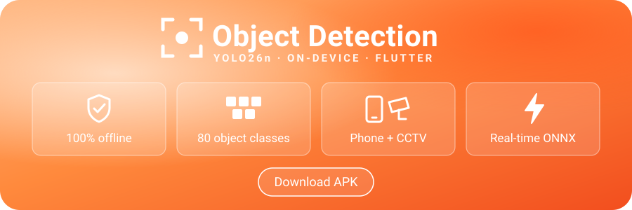

<div align="center">
  <p>
    <a href="https://github.com/Sandeep37-s/didactic-system/raw/master/YOLO_Detector.apk" target="_blank">
      </a>
  </p>

[Features](#-features) | [Download](#-download) | [Quick Start](#-quick-start) | [CCTV Setup](#-cctv-setup) | [Build from Source](#%EF%B8%8F-build-from-source) | [Project Structure](#-project-structure) | [How It Works](#-how-it-works)

<a href="https://flutter.dev"></a>
<a href="https://dart.dev"></a>
<a href="#-download"></a>
<a href="https://onnxruntime.ai"></a>
<a href="https://docs.ultralytics.com"></a>
<br>
<a href="https://github.com/Sandeep37-s/didactic-system/raw/master/YOLO_Detector.apk"></a>

</div>
<br>

**YOLO Detector** is an Android app that runs real-time **object detection** fully on your phone. It uses the **YOLO26n** (nano) model through **ONNX Runtime**, and it can watch either the phone's own **camera** or a **CCTV / IP camera stream** (RTSP or HTTP). Nothing is uploaded: every frame is processed on the device, so it works without internet once the stream is reachable.

It's built for simple home and site **surveillance**. Pick the objects you care about (people, vehicles, animals, and more from the 80 COCO classes), set a confidence threshold, and see live bounding boxes with the inference time for each frame.

## ✨ Features

| | Feature | Details |
| :-: | --- | --- |
| 🔒 | **100% on-device** | The model is bundled in the app. No cloud, no account, no data leaves the phone. |
| 📱 | **Phone camera** | Live detection from the front or back camera. |
| 📹 | **CCTV / IP camera** | Connect to RTSP or HTTP streams from Hikvision, Dahua, CP Plus, DVR/NVR, or the *IP Webcam* app. |
| 🎯 | **80 object classes** | Full COCO label set, grouped into categories (People, Vehicles, Animals, Kitchen, Electronics...). |
| 🎚️ | **Adjustable confidence** | Slider from 10% to 90%, saved between sessions. |
| 🛡️ | **Surveillance preset** | One tap selects people, vehicles and animals. |
| ⚡ | **Smooth UI** | Inference runs on a background isolate and always processes the newest frame, so the preview never freezes. |
| 🕘 | **Recent streams** | Remembers your last 5 camera URLs. |

## 📥 Download

Get the latest build directly:

<div align="center">

**[⬇️ Download YOLO_Detector.apk](https://github.com/Sandeep37-s/didactic-system/raw/master/YOLO_Detector.apk)**

</div>

> [!NOTE]
> Android will ask you to allow **Install from unknown sources** the first time. Requires **Android 7.0 (API 24)** or newer.

## 🚀 Quick Start

1. **Install** the APK and open **YOLO Detector**.
2. Wait for the message *"Nano model loaded · runs 100% on this device"*.
3. Choose a source:
   - **Phone camera**: point the camera at something and boxes appear live.
   - **CCTV camera**: enter a stream address (see [CCTV Setup](#-cctv-setup)).
4. Under **Settings**, adjust the **Confidence threshold** and choose the **Objects to detect**.

## 📹 CCTV Setup

Enter your camera's stream URL when you tap **CCTV camera**. Use the **sub-stream** (lower resolution) when you can, because it is much faster to decode and detect.

| Camera / Source | Example URL |
| --- | --- |
| **Hikvision** | `rtsp://admin:pass@IP:554/Streaming/Channels/102` |
| **Dahua / CP Plus** | `rtsp://admin:pass@IP:554/cam/realmonitor?channel=1&subtype=1` |
| **IP Webcam** (Android app) | `http://IP:8080/video` |

> [!TIP]
> The phone and the camera must be on the **same network** (or the camera must be reachable from the phone). RTSP is forced over **TCP** for better reliability on Wi-Fi.

## 🛠️ Build from Source

**Requirements:** [Flutter SDK](https://docs.flutter.dev/get-started/install) (Dart ≥ 3.11), Android SDK, and a device or emulator.

```bash
git clone https://github.com/Sandeep37-s/didactic-system.git
cd didactic-system/yolo_app

flutter pub get
flutter run                  # run on a connected device
flutter build apk --release  # build the APK
```

The release APK is written to `build/app/outputs/flutter-apk/app-release.apk`.

### Using a different model

The app loads `assets/yolo26n.onnx` (640×640 input, 80 COCO classes). You can export your own with [Ultralytics](https://docs.ultralytics.com):

```bash
pip install ultralytics
yolo export model=yolo26n.pt format=onnx imgsz=640
```

Replace `yolo_app/assets/yolo26n.onnx` with the new file. If your model uses different classes, update `lib/labels.dart` to match.

## 📂 Project Structure

```
didactic-system/
├── YOLO_Detector.apk          # Ready-to-install Android build
├── assets/banner.svg          # README banner
└── yolo_app/                  # Flutter app
    ├── assets/
    │   └── yolo26n.onnx       # YOLO26 nano model (bundled)
    ├── lib/
    │   ├── main.dart          # Home screen, source picker, settings UI
    │   ├── camera_screen.dart # Live detection from the phone camera
    │   ├── cctv_screen.dart   # Live detection from RTSP / HTTP streams
    │   ├── detector.dart      # ONNX inference on a background isolate
    │   ├── overlay.dart       # Bounding-box drawing and class colours
    │   ├── labels.dart        # 80 COCO labels, categories, default preset
    │   └── settings.dart      # Saved settings (confidence, classes, URLs)
    ├── android/               # Android project (minSdk 24)
    └── pubspec.yaml
```

## 🧠 How It Works

```
 Camera / CCTV frame ──▶ Background isolate ──▶ Resize to 640×640 ──▶ YOLO26n (ONNX Runtime)
                                                                            │
 Live preview + boxes ◀── Filter by class & confidence ◀── Detections ◀─────┘
```

- **Phone camera** frames arrive as YUV420 and are rotated upright before inference.
- **CCTV** streams are decoded by [media_kit](https://pub.dev/packages/media_kit) (`mediacodec-copy`, low-latency profile), and BGRA frames are passed to the detector.
- Only **one frame runs at a time**. New frames are dropped while the model is busy, so the result always matches the latest picture.
- ONNX Runtime uses 2 to 4 CPU threads depending on the device.

## 🧰 Tech Stack

| Component | Package |
| --- | --- |
| UI | [Flutter](https://flutter.dev) · Material 3 (dark theme) |
| Inference | [onnxruntime](https://pub.dev/packages/onnxruntime) |
| Camera | [camera](https://pub.dev/packages/camera) |
| Video streams | [media_kit](https://pub.dev/packages/media_kit) |
| Storage | [shared_preferences](https://pub.dev/packages/shared_preferences) |
| Keep screen on | [wakelock_plus](https://pub.dev/packages/wakelock_plus) |
| Model | [Ultralytics YOLO26](https://docs.ultralytics.com) |

## 🔐 Permissions

| Permission | Why |
| --- | --- |
| `CAMERA` | Live detection from the phone camera |
| `INTERNET`, `ACCESS_NETWORK_STATE` | Connecting to CCTV / IP camera streams on your network |
| `WAKE_LOCK` | Keeps the screen on while monitoring |

## 🙏 Acknowledgements

- [Ultralytics](https://github.com/ultralytics/ultralytics) for the YOLO models
- [ONNX Runtime](https://onnxruntime.ai) for fast on-device inference
- [media_kit](https://github.com/media-kit/media-kit) for RTSP / HTTP playback

<div align="center">
<br>
Made with ❤️ by <a href="https://github.com/Sandeep37-s">Sandeep37-s</a>
<br><br>
<a href="https://github.com/Sandeep37-s/didactic-system/raw/master/YOLO_Detector.apk"></a>
</div>
